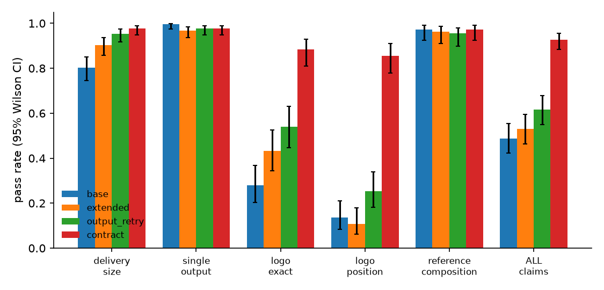

# E2 results

Episodes: 876 · models: ['deepseek-flash'] · seeds: [0, 1, 2] · briefs: 73

## deepseek-flash

### Outcomes by arm

| arm | n | executed | all claims pass (95% CI) | mean claim pass rate | delivery_size | single_output | logo_exact | logo_position | reference_composition | LLM calls | prompt tok | completion tok | LLM s |
|---|---|---|---|---|---|---|---|---|---|---|---|---|---|
| base | 219 | 218/219 | 107/219 = 49% (42%–55%) | 0.754 | 176/219 | 218/219 | 31/111 | 15/111 | 108/111 | 1.0 | 1115 | 566 | 3 |
| extended | 219 | 214/219 | 116/219 = 53% (46%–59%) | 0.799 | 198/219 | 212/219 | 48/111 | 12/111 | 107/111 | 3.3 | 7252 | 1047 | 8 |
| output_retry | 219 | 214/219 | 135/219 = 62% (55%–68%) | 0.842 | 209/219 | 214/219 | 60/111 | 28/111 | 106/111 | 5.9 | 18687 | 1856 | 15 |
| contract | 219 | 214/219 | 203/219 = 93% (88%–95%) | 0.958 | 214/219 | 214/219 | 98/111 | 95/111 | 108/111 | 3.7 | 8745 | 1341 | 9 |

### Failure modes

| arm | no workflow | rejected by ComfyUI validation | execution error | executed |
|---|---|---|---|---|
| base | 1 | 0 | 0 | 218 |
| extended | 4 | 0 | 1 | 214 |
| output_retry | 4 | 0 | 1 | 214 |
| contract | 4 | 0 | 1 | 214 |

### Paired tests (same brief, same seed)

- contract vs extended (all claims pass), 219 paired episodes: contract wins 87, extended wins 0, ties 132; exact McNemar p = 0.0000
- contract − extended (claim pass rate), 219 pairs: mean Δ = +0.159; +88 / −0 / =131; sign test p = 0.0000
- output_retry vs extended (all claims pass), 219 paired episodes: output_retry wins 19, extended wins 0, ties 200; exact McNemar p = 0.0000
- output_retry − extended (claim pass rate), 219 pairs: mean Δ = +0.043; +36 / −11 / =172; sign test p = 0.0003
- contract vs output_retry (all claims pass), 219 paired episodes: contract wins 69, output_retry wins 1, ties 149; exact McNemar p = 0.0000
- extended vs base (all claims pass), 219 paired episodes: extended wins 21, base wins 12, ties 186; exact McNemar p = 0.1628

### By brief family

| family | base all-pass | extended all-pass | output_retry all-pass | contract all-pass |
|---|---|---|---|---|
| edit_ref | 54/54 | 54/54 | 54/54 | 54/54 |
| edit_ref_logo | 4/57 | 3/57 | 15/57 | 48/57 |
| t2i_logo | 8/54 | 7/54 | 12/54 | 47/54 |
| t2i_size | 41/54 | 52/54 | 54/54 | 54/54 |

### By whether delivery size is a multiple of 8

| size % 8 == 0 | base all-pass | extended all-pass | output_retry all-pass | contract all-pass |
|---|---|---|---|---|
| False | 61/144 | 75/144 | 85/144 | 134/144 |
| True | 46/75 | 41/75 | 50/75 | 69/75 |

### Cost of checking

| arm | submits | ComfyUI rejections | brief rejections | generations / episode | conforming outputs | generations per conforming output | LLM tokens per conforming output | check time / episode |
|---|---|---|---|---|---|---|---|---|
| base | 0.00 | 0.00 | 0.00 | 1.00 | 107/219 | 2.04 | 3440 | 0.0 ms |
| extended | 1.00 | 0.02 | 0.00 | 0.98 | 116/219 | 1.84 | 15668 | 0.0 ms |
| output_retry | 1.84 | 0.25 | 0.89 | 1.50 | 135/219 | 2.43 | 33326 | 1589.9 ms |
| contract | 1.41 | 0.02 | 0.41 | 0.98 | 203/219 | 1.05 | 10882 | 0.7 ms |

### Contract-arm overhead

verifier time per episode: mean 0.67 ms; validate calls per episode: extended 0.31, output_retry 0.40, contract 0.32

### Verifier vs actual outcome on shipped, executed LLM workflows (all arms; post-hoc)

| claim | TP (caught) | FN (missed) | FP (false alarm) | TN | abstain |
|---|---|---|---|---|---|
| delivery_size | 62 | 0 | 0 | 785 | 13 |
| single_output | 2 | 0 | 0 | 858 | 0 |
| logo_exact | 164 | 4 | 0 | 223 | 37 |
| logo_position | 240 | 25 | 0 | 147 | 16 |
| reference_composition | 1 | 3 | 0 | 418 | 13 |
| **all** | 469 | 32 | 0 | 2431 | 79 |

## Figures

