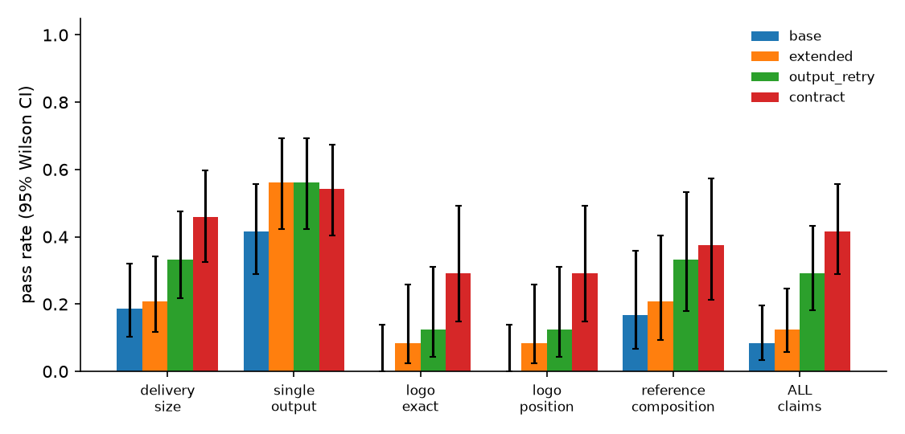

# E2 results

Episodes: 192 · models: ['qwen3.5:4b'] · seeds: [0, 1] · briefs: 24

## qwen3.5:4b

### Outcomes by arm

| arm | n | executed | all claims pass (95% CI) | mean claim pass rate | delivery_size | single_output | logo_exact | logo_position | reference_composition | LLM calls | prompt tok | completion tok | LLM s |
|---|---|---|---|---|---|---|---|---|---|---|---|---|---|
| base | 48 | 20/48 | 4/48 = 8% (3%–20%) | 0.234 | 9/48 | 20/48 | 0/24 | 0/24 | 4/24 | 1.0 | 980 | 494 | 71 |
| extended | 48 | 27/48 | 6/48 = 12% (6%–25%) | 0.335 | 10/48 | 27/48 | 2/24 | 2/24 | 5/24 | 9.1 | 25366 | 1443 | 263 |
| output_retry | 48 | 27/48 | 14/48 = 29% (18%–43%) | 0.420 | 16/48 | 27/48 | 3/24 | 3/24 | 8/24 | 10.8 | 33342 | 2036 | 365 |
| contract | 48 | 26/48 | 20/48 = 42% (29%–56%) | 0.486 | 22/48 | 26/48 | 7/24 | 7/24 | 9/24 | 10.1 | 29977 | 1864 | 338 |

### Failure modes

| arm | no workflow | rejected by ComfyUI validation | execution error | executed |
|---|---|---|---|---|
| base | 1 | 27 | 0 | 20 |
| extended | 12 | 9 | 0 | 27 |
| output_retry | 12 | 9 | 0 | 27 |
| contract | 12 | 10 | 0 | 26 |

### Paired tests (same brief, same seed)

- contract vs extended (all claims pass), 48 paired episodes: contract wins 14, extended wins 0, ties 34; exact McNemar p = 0.0001
- contract − extended (claim pass rate), 48 pairs: mean Δ = +0.151; +15 / −1 / =32; sign test p = 0.0005
- output_retry vs extended (all claims pass), 48 paired episodes: output_retry wins 8, extended wins 0, ties 40; exact McNemar p = 0.0078
- output_retry − extended (claim pass rate), 48 pairs: mean Δ = +0.085; +10 / −0 / =38; sign test p = 0.0020
- contract vs output_retry (all claims pass), 48 paired episodes: contract wins 7, output_retry wins 1, ties 40; exact McNemar p = 0.0703
- extended vs base (all claims pass), 48 paired episodes: extended wins 3, base wins 1, ties 44; exact McNemar p = 0.6250

### By brief family

| family | base all-pass | extended all-pass | output_retry all-pass | contract all-pass |
|---|---|---|---|---|
| edit_ref | 1/12 | 2/12 | 2/12 | 5/12 |
| edit_ref_logo | 0/12 | 0/12 | 1/12 | 3/12 |
| t2i_logo | 0/12 | 0/12 | 1/12 | 3/12 |
| t2i_size | 3/12 | 4/12 | 10/12 | 9/12 |

### By whether delivery size is a multiple of 8

| size % 8 == 0 | base all-pass | extended all-pass | output_retry all-pass | contract all-pass |
|---|---|---|---|---|
| False | 0/28 | 1/28 | 8/28 | 11/28 |
| True | 4/20 | 5/20 | 6/20 | 9/20 |

### Cost of checking

| arm | submits | ComfyUI rejections | brief rejections | generations / episode | conforming outputs | generations per conforming output | LLM tokens per conforming output | check time / episode |
|---|---|---|---|---|---|---|---|---|
| base | 0.00 | 0.00 | 0.00 | 0.42 | 4/48 | 5.00 | 17689 | 0.0 ms |
| extended | 2.23 | 1.67 | 0.00 | 0.56 | 6/48 | 4.50 | 214468 | 0.0 ms |
| output_retry | 3.08 | 1.79 | 0.94 | 1.17 | 14/48 | 4.00 | 121294 | 782.7 ms |
| contract | 2.90 | 1.85 | 0.58 | 0.54 | 20/48 | 1.30 | 76419 | 0.4 ms |

### Contract-arm overhead

verifier time per episode: mean 0.39 ms; validate calls per episode: extended 0.00, output_retry 0.00, contract 0.00

### Verifier vs actual outcome on shipped, executed LLM workflows (all arms; post-hoc)

| claim | TP (caught) | FN (missed) | FP (false alarm) | TN | abstain |
|---|---|---|---|---|---|
| delivery_size | 43 | 0 | 0 | 54 | 3 |
| single_output | 0 | 0 | 0 | 100 | 0 |
| logo_exact | 24 | 0 | 0 | 12 | 0 |
| logo_position | 24 | 0 | 0 | 12 | 0 |
| reference_composition | 11 | 1 | 2 | 24 | 3 |
| **all** | 102 | 1 | 2 | 202 | 6 |

## Figures

